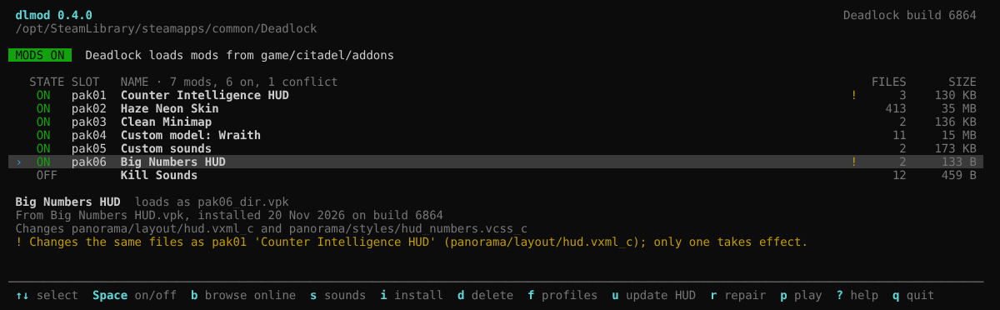
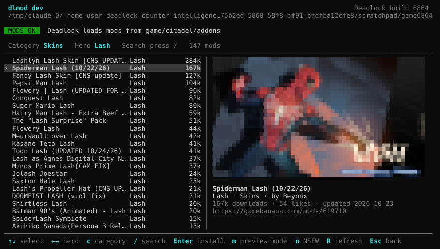

# Deadlock Counter Intelligence

An experimental Panorama HUD for Deadlock. Open the scoreboard or shop to see:

- **Counter items for the enemy lineup.** The three items from the reference counter table that answer the most enemy heroes, with soul price, item category, what the item does against them (for example *Anti-heal* or *CC immunity*), and the enemy heroes it counters. Items you already bought this match are left out.
- **What to buy now.** A **BUY NOW** badge marks the first suggestion your souls can pay for, and prices you cannot reach yet turn grey.
- **What match data says.** Each row shows the estimated change in the buyer's win rate against the current lineup and the minute the item is usually bought, for example `+0.6 WR · ~14m`. A fourth row adds the item with the largest measured gain against the lineup that the table does not already suggest.
- **Lane counters.** For the first ten minutes the fourth row switches to the best early item against the enemies in your lane.
- **Patch warnings.** When a game patch changes an enemy hero after the counter table was last reviewed, a **PATCHED** badge appears next to the title; when it changes a suggested item, that row gets a **!** mark. Hover either one to see what changed, taken from Valve's patch notes or, when Valve changed values without notes, from the game data. The warnings stay until the counters are reviewed for that patch.
- **Enemy counter-purchase alerts.** When an enemy buys an item from the counter list of a hero on your team, a banner names the buyer, the item, and the allies it counters. It stays up for 8 seconds and turns red when the item counters your own hero. Each enemy purchase alerts once per match.

## Reference counter table

`src/counters.json` holds five counter items for every hero, with a short tag per item written from the in-game item description. For 42 heroes they come from the *Counter Eşyalar: kime karşı ne alınır?* series. Pocket and Rat King are not in the series. Their lists come from [Deadlock Item Builder's counter guides](https://deadlockitembuilder.com/counter/pocket), keeping the picks that match data does not contradict, and `otherSources` in the file records how each was chosen. Each item counts once for every enemy hero whose list includes it. Ties go to the item with the larger measured win-rate gain against the lineup, then to the item listed earlier, then to the cheaper item.

To change the reference, edit the item class names in `src/counters.json`. The tests check that every entry exists in the catalog and has a tag.

`reviewed` in the same file records the date the table was last checked against the game and the game build whose data it was checked against, with a later date and build for heroes checked since. `tools/patch_notes.py` collects two kinds of changes into `src/patches.json`:

- **Patch notes.** Every gameplay patch published after the review date, read from deadlock-api's copy of Valve's posts. The tool keeps the lines of the form `- <Hero or item>: <change>`.
- **Changes without patch notes.** Valve sometimes changes values without saying so: build 6833, between the 10-30 and 11-04 updates, raised Spiritual Overflow's spirit lifesteal from 13% to 15%, and no post mentions it. The tool compares the hero, ability, weapon and item values of the reviewed build with those of the current build, as deadlock-api reads them from each build's game files. Every hero or item whose values changed and that no patch note already warns about is listed under *an update without patch notes*, with lines such as `Sovereign's Decree - Bullet damage 5.7 → 5.8`. Abilities most heroes share, such as the jump, are left out, and so are weapon values the game computes from others, such as damage per second.

Those heroes and items carry the PATCHED and **!** warnings. After checking a hero's counters against newer notes or data, set its date and build to the current ones and run the tool again, and its warnings disappear. Right now the series' lists are taken to match the 10-30-2026 update, whose data builds 6826 to 6829 carry. The 11-04-2026 changes to Apollo, Baba, Celeste, Deadman Danny, Mo & Krill, Nurse Harrow and Healbane are flagged, and so is Spiritual Overflow's unannounced change. Rat King and Pocket were checked against match data on build 6864. The 11-18-2026 update (builds 6863 and 6864) changed no hero, ability, weapon or item value and no interface file, so it adds no warnings. Its download was large because it rebuilt about 4,600 hero animation files and replaced Baba's ability effects. It also replaced `gameinfo.gi`, which turns mods off until the search paths are added again (`r` in dlmod).

## Match data

`src/stats.json` is generated by `tools/update_counter_stats.py` from the public [deadlock-api](https://api.deadlock-api.com/docs) item statistics, using its `enemy_hero_ids` filter (ranked and unranked matches at all ranks). The window starts at the latest gameplay patch: the tool reads the patch notes and takes the newest post that changes an item or a hero, so the numbers describe the items as they are now. The current window starts with the 11-04-2026 update, which nerfed Healbane a week after the 10-30 update changed 12 of the counter items. For each item and enemy hero it takes the item's win rate against that hero and subtracts:

1. the item's win rate in all matches, which removes buyer bias (late items are bought by players who are already ahead);
2. the change every buyer sees when that hero is on the enemy team, which removes the hero's overall strength;
3. the average remaining gain of the other items of the same price, which removes the hero's power curve (against a hero who falls off late, every late item looks good).

Changes smaller than two standard errors count as zero, and items need 20,000 purchases against the hero. Steps 1 and 2 reproduce the per-hero numbers published by [Deadlock Academy](https://deadlockacademy.com/counter-items); step 3 is this project's addition. The HUD adds the values over the enemy lineup, which assumes the effects add up.

Lane counters repeat the measurement for players in the same lane as the enemy hero (`same_lane_filter`), counting only items bought in the first ten minutes and costing at most 3,200 souls. The typical buy minute of each item is the average purchase time in the same matches.

`docs/counter-data.md` compares the table with the data for every hero and lists the lane counters. In the current window, 70 of the 220 reference picks raise the buyer's win rate measurably, 92 show no significant change, and 58 lower it. Defensive items bought in reaction to a hero that is already winning look worse than they are, so treat a negative value as "the data does not back this pick", not "the item is useless".

## Research

Counter sites take one of two approaches, and this mod combines both:

- **Curated coverage.** [Deadlock Item Builder's counter helper](https://deadlockitembuilder.com/counter-item-helper) ranks items by how many of up to six enemies they answer and explains each by threat type (anti-heal, gun damage, crowd control, spirit burst). The reference table and tags follow this approach.
- **Match statistics.** [Deadlock Academy](https://deadlockacademy.com/counter-items) and [Worldlock](https://worldlock.org/en/counters/) list the items whose win rate rises most against each hero. [Statlocker](https://statlocker.gg/items) warns that a raw item win rate mostly reflects who buys the item, which is why the match data above corrects for buyer bias, hero strength, and item timing. [Statlocker's matchups](https://statlocker.gg/heroes/matchups), [Deadlock Labs](https://deadlocklabs.gg/heroes/matchups/), and [Counterlock](https://counterlock.gg/) cover hero-against-hero matchups, which matter in the draft rather than in the shop.

## How it reads the game

The suggestion panel sits above the ability bar on the scoreboard and below Quick Buy on the left side of the shop. Everything comes from what the game already shows you, mostly the top bar (panel names from Valve's interface files, as published by [GameTracking-Deadlock](https://github.com/SteamTracking/GameTracking-Deadlock)):

- Both teams' heroes come from the player cards, including their rendered hero names. The card marked `LocalPlayer` identifies your side, and enemy cards marked `IsInLocalPlayerLane` are your lane opponents.
- Your spendable souls come from the shop or HUD balance (`CurrentGoldAmount`), and the match time from the top bar clock (`GameTime`).
- Items you own come from your card's purchased-items panel (`mod_universal`) and from your own rows in the shop's recent-purchase list. The game creates the item icons at run time, so the mod tries the usual item-name properties and ignores anything that is not a known item.
- Enemy purchases come from the shop's recent-purchase list, which the mod reads every half second while the shop is open, so alerts appear when you open the shop.

The PATCHED badge and the **!** marks are the only parts of the panel that react to the mouse; everything else lets clicks through to the game. Hovering needs a mouse cursor, which the shop always has.

When the enemy lineup changes, the mod treats it as a new match and clears its alert history and owned items. Suggestions are only recomputed when the lineup, the lane phase or your items change; souls only move the badge.

The recommendation engine, HUD state changes, and archive format are covered by local tests. Displaying the HUD in Deadlock still requires in-game verification. If one of the panels above turns out to be named differently in game, its feature switches itself off: no badge without souls, no lane row without lane opponents, and owned items stay listed. The HUD does not track item sales.

## Install

Close Deadlock first, and use one install method only: two tools editing the same game fight over `gameinfo.gi`.

### With dlmod (no mod manager)

`dlmod` is a 3 MB program in [`tools/dlmod`](tools/dlmod). It uses only Go's standard library and has no installer or background service. It finds Deadlock through Steam, copies mods into `game/citadel/addons` under free `pakNN_dir.vpk` names, and edits `gameinfo.gi` so the game loads that folder. It works with any VPK mod, not just this one, and installs `.zip`, `.rar` and `.7z` downloads. It goes online only when you browse or download mods or update the HUD, through the `curl` that comes with Windows 10 and later, which keeps dlmod half the size it would be with its own HTTPS code. `.rar` and `.7z` archives are opened with the `tar.exe` that also comes with Windows (or 7-Zip, if installed).

1. From [GitHub Releases](https://github.com/MrHakan/deadlock-counter-intelligence/releases), download the HUD ZIP and `dlmod-windows-amd64.exe` (on Linux, `dlmod-linux-amd64`).
2. Drag the ZIP onto `dlmod-windows-amd64.exe`.
3. Start Deadlock.

Double-click dlmod to open its full-screen view of every mod, with its slot, file count, size, and conflicts or update warnings. It updates by itself when something changes outside it: a game update, a mod added by hand, or Deadlock starting.



| Key | Action |
| --- | --- |
| `↑` `↓` (or `j` `k`) | Select a mod |
| `Space` or `Enter` | Switch the selected mod on or off. It keeps its place in the list. |
| Drag a file into the window | Install it straight away. `i` lets you type a path instead. |
| `b` | Browse mods online and install them (see below) |
| `d` | Delete the selected mod, after a confirmation |
| `f` | Profiles: switch to a saved set of mods, save the mods that are on now, or delete a profile |
| `u` | Download the Counter Intelligence HUD for your game build and replace the old one (asks first) |
| `r` | Repair `gameinfo.gi` after a game update |
| `x` | Undo dlmod's `gameinfo.gi` change; mods stay installed but stop loading |
| `p` | Start Deadlock through Steam |
| `?` | Help |
| `q` or `Esc` | Quit |

#### Browsing mods online

`b` opens the catalog Deadlock Mod Manager uses: about 12,000 mods mirrored from GameBanana by [deadlockmods.app](https://deadlockmods.app), each with its hero and category. dlmod downloads the list once (about 15 MB) and keeps it for six hours; `R` downloads it again. It opens on skins, most downloaded first. `←` `→` pick a hero, `c` cycles the category, `/` searches names and authors, and `n` shows NSFW mods, which are hidden otherwise. `Enter` downloads the selected mod, checks its published MD5, and installs it like a dropped file, asking which file when a mod has several (often with or without voice lines). The mod's files come from deadlockmods.app, or from GameBanana's own API when the mirror has none.



The selected mod's preview is drawn in the terminal. dlmod draws pictures itself, with no extra library:

| Preview mode (`m`) | Where it works |
| --- | --- |
| blocks | Any terminal with 24-bit colour: Windows Terminal, the Windows 10+ console, macOS and Linux terminals. Each character shows two pixels with `▀`, so pictures are coarse. |
| sixel | Full resolution in Windows Terminal 1.22 or later, WezTerm, foot, mlterm and xterm (`-ti vt340`). |
| kitty | Full resolution in kitty, Ghostty and WezTerm. |

dlmod starts with kitty in kitty and Ghostty, sixel in WezTerm and foot, and blocks elsewhere, including Windows Terminal, whose version it cannot see. Set `DLMOD_IMAGES=sixel` (or `blocks`, `kitty`, `off`) to choose. Previews are cached in `game/dlmod/catalog/previews`.

Deadlock updates and Steam's *Verify integrity of game files* replace `gameinfo.gi`, which turns all mods off. The screen then shows **MODS OFF**: press `r`, or start the game with `dlmod play`, which repairs first. Consoles older than Windows 10 get a numbered menu instead, which `-plain` also selects.

The full-screen view needs about 5–8 MB of memory. While it waits it checks four file timestamps (and whether the game is running) once a second, and redraws only when something changed. Key presses take under a millisecond to show. On Windows, dlmod reads Steam's location from the registry and checks for the game through the system API, without starting other programs. Listing 40 mods, two of them with 6,000 files each, takes about 5 ms.

| Command | What it does |
| --- | --- |
| `dlmod <file.zip, .rar, .7z or .vpk>` | Install mods, including multi-part sets (`pakNN_000.vpk`). If a newer version changes the same files, dlmod offers to replace the old one in its slot. |
| `dlmod list` | Show mods, conflicts between them, and whether the game loads mods. |
| `dlmod off <mod>` / `dlmod on <mod>` | Move a mod out of `addons` without deleting it, and back. |
| `dlmod remove <mod>` | Delete a mod. |
| `dlmod patch` / `dlmod unpatch` | Add or remove dlmod's `gameinfo.gi` lines. `unpatch` restores Valve's file exactly. |
| `dlmod play` | Patch if needed, then start Deadlock through Steam. |
| `dlmod update` | Download the Counter Intelligence HUD built for the installed game build from GitHub Releases, check it against GitHub's published SHA-256, and install it in place of the old version. |
| `dlmod search <words> [-hero H] [-category C]` | Search the online catalog, for example `dlmod search -hero wraith` or `dlmod search catgirl`. |
| `dlmod get <id or GameBanana address>` | Download and install a mod, for example `dlmod get https://gamebanana.com/mods/634614`. |
| `dlmod profile save <name>` / `use <name>` / `delete <name>` | Remember which mods are on, switch on exactly that set later (everything else is switched off, not deleted), or forget a profile. `dlmod profile` lists them. |

`<mod>` is a number from `dlmod list`, a slot such as `pak03`, or part of the mod's name. dlmod finds the game through Steam's library folders. If it cannot, pass `-game "D:\SteamLibrary\steamapps\common\Deadlock"`. It keeps its list of mods, switched-off mods, and a copy of the previous `gameinfo.gi` in `game/dlmod`, which the game never reads.

Windows SmartScreen may warn about the program because it is not signed. Choose **More info → Run anyway**, or build it yourself with `go build` in `tools/dlmod`.

### By hand

1. In Steam, right-click Deadlock and choose **Manage → Browse local files**, then open `game\citadel`.
2. Back up `gameinfo.gi` and open it in Notepad. In the `SearchPaths` block, add the five marked lines and change nothing else:

   ```
   SearchPaths
   {
       Game_UILanguage     citadel_*LANGUAGE*
       Game_LowViolence    citadel_lv
       Game                citadel/addons      <- add
       Mod                 citadel             <- add
       Write               citadel             <- add
       Game                citadel
       Mod                 core                <- add
       Write               core                <- add
       Game                core
   }
   ```

   Type only the paths, without the `<- add` notes. The `Game` line makes the game read mods before its own files. Without the `Mod` and `Write` lines, the game would treat `addons` as its settings folder and save keybinds there.
3. Create a folder named `addons` (lowercase) in `game\citadel` if it does not exist.
4. Extract `pak01_dir.vpk` from the ZIP into `addons`. If another mod already uses that name, rename this one to a free number between `pak02_dir.vpk` and `pak99_dir.vpk`. Files with other names, or in subfolders, do not load.
5. Start Deadlock.

After a game update or *Verify integrity*, redo step 2 on the new `gameinfo.gi` instead of copying back an old one, because Valve's other changes would be lost. To remove the mod, delete its VPK. To stop loading all mods, run *Verify integrity*.

### With Deadlock Mod Manager

1. In Deadlock Mod Manager v2.3.0, open **Mods Library → Add Local Mod** and import the ZIP.
2. Enable the mod and launch Deadlock through Mod Manager.

Use Mod Manager to disable or remove the mod.

### Notes for every method

If two mods change the same file, only one of them takes effect, and guides disagree on whether the lower or the higher `pakNN` number wins. This mod replaces `panorama/layout/hud.vxml_c`, so do not combine it with another HUD mod; `dlmod list` shows such conflicts. A HUD mod built for an older game build can stop Deadlock from starting after a large update (for example with an "Unable to find child" error). Switch it off and use the release built for the new game build.

## Build the VPK

Building requires Python 3.9+, a Steam installation of Deadlock, and [Source2Viewer-CLI](https://github.com/ValveResourceFormat/ValveResourceFormat/releases). The build reads the base HUD layout from the installed game.

```powershell
py -3 tools/build.py --deadlock-dir "C:\Program Files (x86)\Steam\steamapps\common\Deadlock" --vrf "C:\Tools\Source2Viewer-CLI.exe"
```

If you already have the extracted stock layout, use `--hud-xml path/to/hud.xml`. [GameTracking-Deadlock](https://github.com/SteamTracking/GameTracking-Deadlock/blob/master/game/citadel/pak01_dir/panorama/layout/hud.xml) publishes it for the live build. The build produces `dist/deadlock-counter-intelligence-experimental.zip` with one `pak01_dir.vpk` inside.

`.github/workflows/game-update.yml` runs every day. When Deadlock's client build changes, it refreshes the catalog, the match data and the patch warnings (from the notes and from the game data), runs every test, builds the mod against the new stock HUD, commits the update to `main`, and starts the release workflow for the next patch version, so a HUD for the new build is usually available within a day of a game update. If deadlock-api does not have the new build yet, it tries again the next day; if a test or the build fails, nothing is released. It can also be run from the Actions tab.

`.github/workflows/release.yml` publishes releases. It runs when a `v*` tag is pushed, or from the Actions tab: choose **Release → Run workflow** and enter a version such as `v0.2.0`, and it creates the tag on the commit it builds. It runs the tests, builds the ZIP from the GameTracking layout (and stops if that layout is from a different build than the catalog), builds dlmod for Windows and Linux, and publishes a release with the notes in `.github/release-notes/<version>.md`.

## Catalog and tests

The bundled catalog targets Deadlock client build **6864** and contains 173 shop items, with price and shop category, and 44 hero records. The HUD displays English names. Turkish aliases help match item and hero names read from the game client. When targeting a new build, refresh the catalog and use the stock HUD from that build.

```sh
python tools/update_catalog.py 6864
python tools/update_counter_stats.py
python tools/patch_notes.py
node --test test/intelligence.test.js
python -m unittest discover -s test -v
```

`update_counter_stats.py` makes 90 API requests and takes a few minutes. Pass `--cache DIR` to keep the raw responses and regenerate without downloading again. `patch_notes.py` downloads the hero and item data of the reviewed and the current build, about 17 MB; `--notes-only` skips that comparison.

Ambiguous labels are skipped. During a match, the mod works from the visible HUD and the bundled catalog, counter table, and match data. It makes no network requests.

For in-game verification, use a private lobby. With the console open, loading a match prints `[DCI] Counter items HUD loaded`; if that line is missing, the script did not load, and the panel stays at its layout defaults. Check that the suggestions match the enemy lineup, that the fourth row shows a lane pick before minute 10 and a match-data pick after it, that the BUY NOW badge follows your souls, that an item you buy disappears from the suggestions, that hovering PATCHED (for example with Celeste or Baba on the enemy team) shows their changes and that the panel does not block clicks in the shop, that an enemy buying an item from an ally's counter list (for example Healbane against Infernus) shows the banner, that an allied purchase is ignored, and that disabling the mod restores the stock HUD.

## References

- Manual install and `gameinfo.gi` search paths: [Divine Skins wiki](https://wiki.divineskins.gg/en/docs/deadlock/getting-started/install-by-hand), its [troubleshooting page](https://wiki.divineskins.gg/en/docs/deadlock/errors/mods-not-loading), and the [Deadlock Mod Manager guide](https://deadlockmods.app/how-to-install-deadlock-mods)
- [Deadlock Mod Manager local mod guide](https://docs.deadlockmods.app/using-mod-manager/library#add-local-mods) and [Live bridge source](https://github.com/deadlock-mod-manager/deadlock-mod-manager/blob/v2.3.0/apps/desktop/src-tauri/src/live_bridge/dmm_live_bridge.js)
- [Deadlock API](https://api.deadlock-api.com/docs) and [GameTracking-Deadlock HUD layout](https://github.com/SteamTracking/GameTracking-Deadlock/blob/master/game/citadel/pak01_dir/panorama/layout/hud.xml)
- [Threat HUD shop layout](https://github.com/antonborndev/deadlock-threat-hud/blob/9fc4cbfd7290c834eb81490ecc004c578ae4fbba/threathud/panorama/layout/citadel_hud_hero_shop.xml) and [BiggerIdleMap build example](https://github.com/regulad/BiggerIdleMap)
- `third_party/panorama.py` comes from the [MIT-licensed Panorama compiler in BiggerIdleMap](https://github.com/regulad/BiggerIdleMap/blob/d54483205cbc01a3f496d536e338f58b919c2caa/panorama.py). The original copyright and license notices are included in that file.
